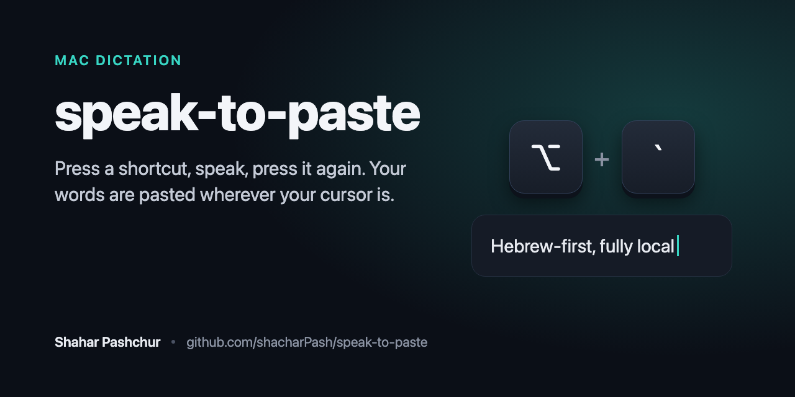

# speak-to-paste



[English](README.md)

לוחצים על קיצור מקלדת, מדברים, לוחצים שוב, והטקסט מודבק בדיוק איפה שהסמן נמצא: וואטסאפ, סלאק, מייל, דפדפן, כל שדה טקסט.

הכל רץ מקומית על המחשב: בחינם, בלי הגבלה, בלי חשבון ובלי לשלוח הקלטות לענן.

**שפות:** הכלי מותאם לעברית, וגם לעברית עם מילים באנגלית באמצע (PR, full access, KPI), שנכתבות באותיות לטיניות. גם משפטים שלמים באנגלית עובדים ברוב המקרים.

## מה צריך

- מק עם שבב Apple Silicon (M1 ומעלה). מקים עם מעבד אינטל לא נתמכים.
- גרסת macOS 14 (Sonoma) ומעלה.
- בערך 2GB פנויים בדיסק.

## התקנה: פקודה אחת

**ראשית**, פותחים את הטרמינל: לוחצים `Cmd + Space`, מקלידים `Terminal` ולוחצים Enter.

**אחר כך**, מדביקים את השורה הזו ולוחצים Enter:

```bash
/bin/bash -c "$(curl -fsSL https://raw.githubusercontent.com/shacharPash/speak-to-paste/main/install.sh)"
```

הסקריפט מוריד את האפליקציה ואת המודל (1.6GB, כמה דקות), מוודא ששניהם תקינים ומקוריים, מגדיר הכל ופותח את האפליקציה. לא צריך סיסמה ולא צריך להתקין שום דבר אחר.

**לסיום**, בחלון של האפליקציה יופיעו שתי הרשאות חד-פעמיות. לוחצים על Grant Access ליד כל אחת:

- **מיקרופון** (Microphone Access): מאשרים בחלון שקופץ.
- **נגישות** (Accessibility Access): נפתחות הגדרות המערכת, ומדליקים שם את OpenSuperWhisper. בלי ההרשאה הזו האפליקציה לא יכולה להדביק את הטקסט.

## איך משתמשים

- שמים את הסמן בשדה טקסט כלשהו.
- לוחצים על Option יחד עם המקש `` ` `` (המקש שמשמאל ל-1), ומדברים.
- לוחצים שוב על אותו קיצור. אחרי שנייה-שתיים הטקסט מודבק.

מי שמעדיף, יכול גם להחזיק את הקיצור לאורך כל הדיבור ולשחרר בסוף. שני הסגנונות עובדים. את הקיצור עצמו אפשר להחליף בהגדרות של האפליקציה.

ההקלטה הראשונה אחרי שהאפליקציה עולה איטית יותר, כי המודל נטען לזיכרון. משם זה מהיר.

## עדכון

מריצים שוב **את אותה פקודה בדיוק**. הסקריפט מעדכן מה שצריך ומדלג על מה שכבר מעודכן. הגדרות ששיניתם בעצמכם נשמרות.

אם רוצים לחזור להגדרות המומלצות, מוסיפים `--reset-settings` בסוף:

```bash
/bin/bash -c "$(curl -fsSL https://raw.githubusercontent.com/shacharPash/speak-to-paste/main/install.sh)" _ --reset-settings
```

## אם משהו לא עובד

- **הטקסט לא מודבק:** חסרה הרשאת נגישות. נכנסים להגדרות מערכת, פרטיות ואבטחה, נגישות (Accessibility), מדליקים את OpenSuperWhisper, וסוגרים ופותחים את האפליקציה מחדש.
- **הקיצור לא עושה כלום:** אולי אפליקציה אחרת תפסה אותו. בהגדרות של OpenSuperWhisper אפשר לבחור קיצור אחר.
- **משפט באנגלית יצא בעברית:** זה קורה לפעמים במצב Auto. אם מכתיבים הרבה באנגלית, בוחרים English בתפריט Language של האייקון בשורת התפריטים, ומחזירים ל-Auto בסוף.
- **ההורדה נקטעה:** מריצים שוב את אותה פקודה, והיא ממשיכה מאיפה שעצרה.

## מה הסקריפט עושה בדיוק

- בודק שזה מק עם Apple Silicon ו-macOS 14 ומעלה.
- מוריד את OpenSuperWhisper מהעמוד הרשמי שלה ב-GitHub, ובודק גם checksum וגם את חתימת המפתח (Apple notarized) לפני ההתקנה.
- מוריד את המודל מה-Hugging Face של ivrit.ai ובודק checksum.
- בהתקנה ראשונה כותב את ההגדרות ומדלג על מסך הפתיחה, כי מסך הפתיחה מחליף את השפה לשפת המערכת ואת קיצור המקלדת.
- אפשר לקרוא את כל הקוד כאן: [install.sh](install.sh).

## קרדיט

- האפליקציה [OpenSuperWhisper](https://github.com/Starmel/OpenSuperWhisper) של Starmel, בקוד פתוח, היא זו שמקליטה, מתמללת ומדביקה.
- המודל העברי הוא של [ivrit.ai](https://huggingface.co/ivrit-ai/whisper-large-v3-turbo-ggml).
- הפרויקט הזה הוא ההתקנה וההגדרות שמחברות ביניהם, בפקודה אחת.

## הסרה

```bash
osascript -e 'quit app "OpenSuperWhisper"'; rm -rf /Applications/OpenSuperWhisper.app ~/Applications/OpenSuperWhisper.app "$HOME/Library/Application Support/ru.starmel.OpenSuperWhisper"; defaults delete ru.starmel.OpenSuperWhisper
```
