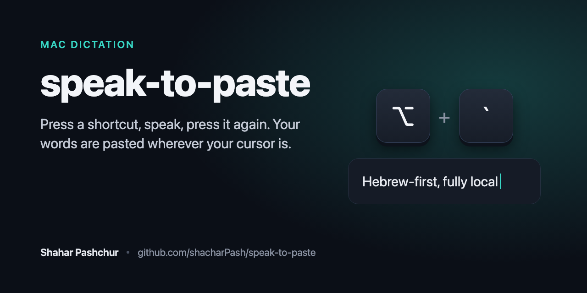

# speak-to-paste



**Press a shortcut, speak, press it again: what you said is pasted wherever your cursor is, anywhere on your Mac.**

Hebrew-first (the [ivrit.ai](https://huggingface.co/ivrit-ai/whisper-large-v3-turbo-ggml) model), and it handles English and mixed Hebrew-English too. Fully local, free and unlimited: no account, and no audio ever leaves your Mac. One command to install, the same command to update.

[לקריאה בעברית](README.he.md)

## Requirements

- An Apple Silicon Mac (M1 or newer). Intel Macs are not supported.
- macOS 14 (Sonoma) or newer.
- About 2 GB of free disk space.

## Install

Open Terminal (`Cmd + Space`, type `Terminal`, press Enter) and paste:

```bash
/bin/bash -c "$(curl -fsSL https://raw.githubusercontent.com/shacharPash/speak-to-paste/main/install.sh)"
```

The script downloads the app and the model (1.6 GB, a few minutes), verifies both, configures everything and opens the app. No password, nothing else to install.

Then grant two one-time permissions in the app window by clicking **Grant Access** next to each:

- **Microphone Access**: allow it in the popup.
- **Accessibility Access**: System Settings opens; switch OpenSuperWhisper on. This is what lets it paste the text for you.

## Use

1. Put the cursor in any text field: WhatsApp, Slack, mail, the browser, your editor.
2. Press `Option` + `` ` `` (the key left of 1) and speak.
3. Press it again. A second or two later the text is pasted at the cursor.

Prefer push-to-talk? Hold the shortcut while you speak and release at the end; both styles work. The shortcut can be changed in the app's settings. The first transcription after launch is slower while the model loads.

**Languages:** tuned for Hebrew, including English terms inside Hebrew sentences, which come out in Latin letters (PR, full access, KPI). Full English sentences work most of the time. If you are dictating mostly English for a while, pick English from the Language menu of the menu bar icon and switch back to Auto afterwards.

## Update

Run the same command again. It updates what changed and skips the rest. Settings you changed yourself are kept. To restore the recommended settings, add `--reset-settings`:

```bash
/bin/bash -c "$(curl -fsSL https://raw.githubusercontent.com/shacharPash/speak-to-paste/main/install.sh)" _ --reset-settings
```

## Troubleshooting

- **The text is not pasted:** the Accessibility permission is missing. Open System Settings, Privacy & Security, Accessibility, enable OpenSuperWhisper, then quit and reopen the app.
- **The shortcut does nothing:** another app may already use it. Pick a different shortcut in OpenSuperWhisper's settings.
- **An English sentence came out in Hebrew:** this happens occasionally in Auto mode. Switch the language to English from the menu bar icon.
- **The download was interrupted:** run the same command again; it resumes where it stopped.

## What the script does

- Checks for an Apple Silicon Mac with macOS 14 or newer.
- Downloads OpenSuperWhisper from its official GitHub release and, before installing, verifies its checksum, its developer signature (the OpenSuperWhisper developer's Apple team ID) and its Apple notarization ticket.
- Downloads the model from ivrit.ai on Hugging Face and verifies its checksum.
- On first install, writes the settings and skips the app's onboarding screen, which would otherwise reset the language to the system language and change the shortcut. If you already used OpenSuperWhisper, its engine, model, language, shortcut and a few other settings are replaced.
- Everything is in one readable file: [install.sh](install.sh).

## Credits

- [OpenSuperWhisper](https://github.com/Starmel/OpenSuperWhisper) by Starmel, open source, does the recording, transcription and pasting.
- The Hebrew speech model is by [ivrit.ai](https://huggingface.co/ivrit-ai/whisper-large-v3-turbo-ggml).
- This project is the installer and configuration that connects them in one command.

## Uninstall

This removes OpenSuperWhisper itself, its downloaded models and its settings, including anything you set up in OpenSuperWhisper before using speak-to-paste.

```bash
osascript -e 'quit app "OpenSuperWhisper"'; rm -rf /Applications/OpenSuperWhisper.app ~/Applications/OpenSuperWhisper.app "$HOME/Library/Application Support/ru.starmel.OpenSuperWhisper"; defaults delete ru.starmel.OpenSuperWhisper
```

## License

[MIT](LICENSE)
